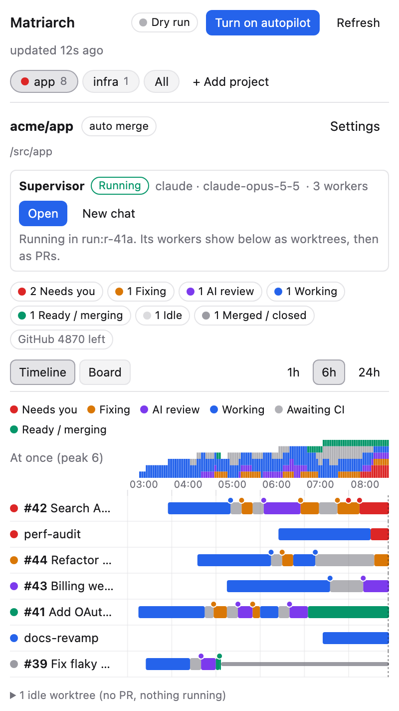
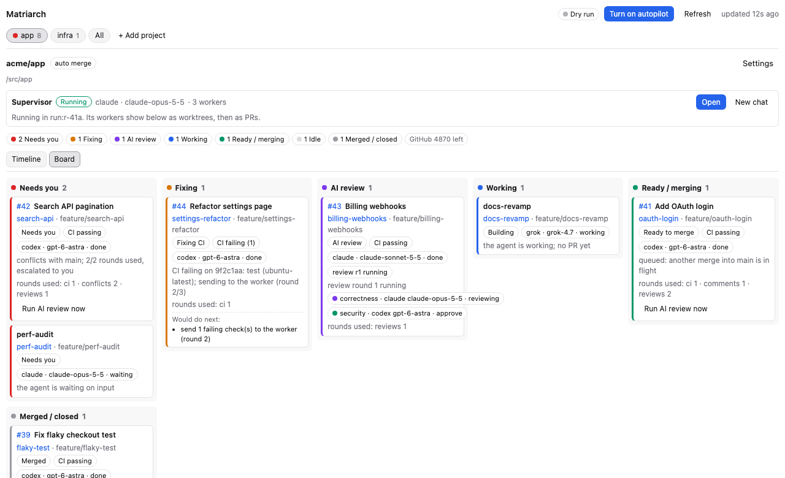
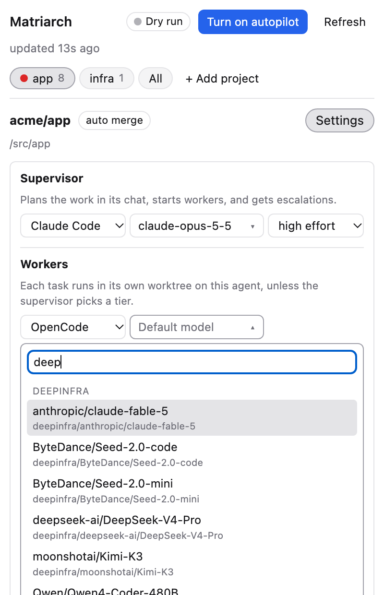

# Matriarch



A supervisor for your pod of coding agents in [Orca](https://www.onorca.dev). You tell a
supervisor agent what to build; it plans the work and starts workers, each in its own worktree,
on the agents and models you picked. Matriarch then drives every PR they open through CI, review
comments, conflicts, an AI review by a crew of reviewers on several providers, fixes, and merge,
and shows all of it on one timeline.

It starts in **dry run**: it watches and shows what it would do until you turn on autopilot.

<br clear="right">

## How a PR moves

1. **Plan.** You describe the work in the project's supervisor chat. The supervisor shows you a
   plan, and once you agree it creates tasks and starts a worker for each, in its own worktree.
2. **Build.** Workers push branches and open PRs.
3. **CI, comments, conflicts.** A failing check, an unresolved review comment or a conflict goes
   back to the worker that owns the branch, with the details. A branch that falls behind its base
   is updated.
4. **AI review.** When CI passes, a review crew reads the PR in a throwaway worktree: several
   reviewers, each on its own agent and model, each with its own focus. Their verdicts are combined
   by your rule (every must-approve reviewer approves, a majority, or no blockers). Findings go to
   the worker; later rounds check only what changed.
5. **Merge.** Matriarch marks the PR ready for you to merge, or merges the reviewed commit itself
   if the project allows it.

Anything that needs a decision goes to the supervisor first, then to you after a while. The
supervisor is told to keep the run moving without you, and Matriarch never answers an agent's
permission prompt for you: those show as **Needs you**.

## Requirements

- Orca **1.4.257** or newer, with orchestration turned on (Settings → Experimental), so the
  supervisor can start and message workers.
- The GitHub CLI, `gh`, signed in. Projects must be on GitHub.
- The agents you want to use, installed and signed in. Any agent Orca can start works as the
  supervisor or a worker; reviewers start read-only only on **Claude Code** and **Codex**.
- `git`, and `sqlite3` to read your Orca settings (macOS includes it).

Matriarch has been run on macOS. It should work wherever Orca and these tools do, but Linux and
Windows are untested.

## Install

**From Orca's plugin directory:** Settings → Plugins, search for Matriarch, and install.

**From GitHub:**

```sh
orca plugin install VerifiedOrganic/orca-matriarch
```

Either way Orca shows what it asks for (see [Permissions](#permissions)) and asks you to approve it.

**From a clone,** to change it: see [Develop](#develop).

## Get started

1. Open the **Matriarch** panel in the right sidebar, or run **Matriarch: Show board**.
2. Click **+ Add project**, then **Turn on** for a project open in Orca. It needs a GitHub origin
   and at least one commit on its main branch; the list says when it does not.
3. In **Settings**, pick the agent, model and effort for the supervisor, the workers (plus any
   worker tiers, such as a cheaper one for small tasks) and each reviewer. Then **Save**. The
   agents offered are the ones turned on in your Orca settings and installed; the model box
   searches the models each agent offers you now.
4. Click **Open supervisor chat** and tell it what to build.
5. Watch the timeline in dry run. When you are happy with what it would do, **Turn on autopilot**.

Settings are saved in the project's `.orca/matriarch.json`, so you can commit them to share with
your team. Nobody has to edit that file: every setting Matriarch uses is in **Settings**, and
[DESIGN.md](DESIGN.md#roles-and-config) describes each field. **Turn Matriarch off here**, at the bottom of Settings, keeps them for later. Matriarch
manages only PRs you opened from a branch that belongs to an Orca workspace.

## What you see



- **Projects:** a chip per project, **All** for every project on one timeline, and **+ Add
  project**. The panel follows the workspace you focus in Orca.
- **Timeline:** one row per worktree or PR, colored by state: working, awaiting CI, fixing, AI
  review, needs you, ready, merged. Dots mark pushes, messages, reviews, escalations and merges.
  Worktrees with no PR and nothing running fold into one line.
- **Board:** cards by state with the agent and model, CI, comments and rounds used, and in dry
  run what Matriarch would do next. **Run AI review now** on any card runs the crew on that
  commit, in dry run too.
- **Supervisor:** each project's chat, with the Run it coordinates and how many workers it has.
- **Needs you:** a reviewer waiting on a prompt, an escalation that reached you, a nearly full
  disk. The status bar shows the same at a glance.
- **Full tab:** tab bar **+** → **Matriarch board**.



## What it costs

Matriarch runs agents on **your** accounts, and each one uses your plan or API credit: the
supervisor chat, one worker per task, every reviewer on every review round, and the fix rounds
after it. A PR that needs several rounds costs several reviews. To keep it in hand:

- choose cheaper models for worker tiers and for some reviewers;
- **Review rounds per PR** (default 3) caps the rounds before it asks someone instead;
- later rounds check only what changed (**Later rounds: check the fixes**);
- reviewers on the same agent as the PR's author are skipped (you can turn that off);
- **Reviews at once** (default 2) limits how many review crews run together.

When a reviewer's account hits its usage limit, Matriarch can restart it once on a fallback
model you choose; otherwise it shows the reviewer as **Needs you**.

## Permissions

Matriarch is a **full-access** plugin (`trusted-worker`): its worker runs as you, on your
machine, so Orca asks you to approve it on install. It needs that to run `git`, `gh` and `orca`,
start agents and read their state. It asks Orca for these capabilities:

- **Read workspaces** (`workspace:read`): lists your projects and worktrees, finds the workspace
  you have focused, and hears when workspaces are created or removed.
- **Open workspaces** (`workspace:write`): opens a project or a worktree when you click it, and
  runs Orca's own command to show the sidebar.
- **Read agents** (`agent:read`): which agents are running, working or waiting, in which
  workspace.
- **Show notifications** (`notifications:show`): tells you when something needs you while Orca
  is in the background.
- **Own storage** (`storage:own`): keeps each PR's history and review state in the plugin's own
  storage.
- **Own settings** (`settings:own`): autopilot on or off, and how often it checks GitHub.

It also adds two **hooks** that apply only to agents launched in a review worktree:

- **Before an agent launches** (`agent.launch.before`), a reviewer's command is rewritten so it
  starts read-only, whatever permission mode you chose in Orca:
  - Claude Code: `--dangerously-skip-permissions` and any other permission mode are removed, and
    `--permission-mode dontAsk` is set with an allowlist (read and search inside the worktree,
    read-only `git` and shell commands, and writing only its own notes under
    `.matriarch/review/`) and a denylist (paths outside the worktree, `git push`/`commit`, `gh`
    writes, `gh api`, `rm`, web fetches), plus `--setting-sources user --strict-mcp-config`.
  - Codex: the bypass flags are removed and it runs with `--sandbox workspace-write
    --ask-for-approval never`, no network, no extra writable folders and no MCP servers.
  - Any other agent is refused as a reviewer unless you mark that reviewer **Run it without the
    read-only lockdown**.
- **Before an agent uses a tool** (`agent.tool.before`), a reviewer's tool call that would write
  outside its notes, or run a command that is not read-only, is blocked.

A reviewer that did not start locked down is stopped and started again, or shown as failed.
Supervisor and worker launches are not changed.

## What it runs on your machine

| Command | When |
|---|---|
| `git -C <workspace> rev-parse …`, `git config --get remote.origin.url` | find the repository behind each workspace |
| `gh api -X HEAD -i -H 'If-None-Match: …'` | each check: ask GitHub whether PRs, the default branch or followed checks changed (free when nothing did) |
| `gh api graphql` | read open PRs, CI checks and review threads, when something changed |
| `gh api repos/<repo>/actions/jobs/<id>/logs` | autopilot: the tail of a failed job's log, for the worker |
| `orca agent launch --surface chat …` | **Open supervisor chat**: the supervisor, on your model, with its brief |
| `orca terminal create` | once per project: a terminal titled "Matriarch mailbox" (`cat > /dev/null`), which Orca requires as the sender of Matriarch's messages |
| `orca orchestration worker-list`, `run-list` | find the worker that owns each branch, and the supervisor's Run |
| `orca orchestration send --from <mailbox>` | autopilot: CI failures, comments, AI findings and update requests to a worker; escalations to the supervisor |
| `git fetch origin …`, `orca worktree create`, `orca agent launch --model …`, `orca worktree rm` | a review round: a throwaway worktree at the PR head, one agent per reviewer, removed afterwards |
| `orca terminal close` | a reviewer that started without its lockdown is stopped |
| `gh api repos/<repo>/pulls/<n>/reviews` | autopilot, when **Where reviews go** includes the PR: one comment review per round |
| `gh pr update-branch` | autopilot: update a branch that is behind its base |
| `gh pr merge --match-head-commit <sha>` | autopilot, when the project lets Matriarch merge: merge exactly the reviewed commit |
| `git -C <worktree> status --porcelain`, `orca worktree rm --delete-branch` | autopilot: remove a merged PR's worktree when nothing runs there and nothing is uncommitted |
| `sqlite3 'file:…?mode=ro'` | read your Orca settings (below), read-only |
| `opencode api model.list` | **Settings**: the models OpenCode offers you now, from every provider you signed in to |
| `orca --version` | **Settings**: say when this Orca is not the one Matriarch was tested with |

It never passes `--admin` and never bypasses branch protection.

### What it reads from Orca's own files

Orca's plugin API does not yet tell plugins which agents you turned off, the commands you set for
them, the workspace you focused, or the models each agent offers. Matriarch reads these from
Orca's data folder, read-only, and nothing else in it:

- `orca-profile-index.json`: which profile is active.
- `profiles/<id>/profile-state.db`: three fields, `disabledTuiAgents`, `agentCmdOverrides` and
  the focused workspace.
- `agent-model-catalog.db`: the models Orca discovered for each agent.

These are Orca's internal files and may change in a later Orca. When Matriarch cannot read them,
**Settings** says so and it falls back: every installed agent is offered, and a model id can be
typed. [docs/orca-api-requests.md](docs/orca-api-requests.md) lists the plugin APIs that would
replace them.

### Network and data

Matriarch talks to the network only through `gh`, to GitHub. It sends nothing anywhere else and
has no telemetry. Each PR's history and review state stay in the plugin's own storage on your
machine; each project's settings are in its `.orca/matriarch.json`; reviewers' notes are written
in their throwaway worktree and removed with it.

## Limits

- GitHub only, and only PRs you opened from an Orca workspace's branch.
- Read-only reviewers on Claude Code and Codex only.
- It relies on Orca's orchestration behaving as it does in 1.4.257, and on the files above.
  Settings says when you run a different Orca.
- Orca tells plugins only a workspace's name and branch, so when two projects' own checkouts are
  both "main" with no terminal open, the panel asks you to pick the project.

## Develop

```sh
pnpm install            # TypeScript, and Node's typings
pnpm types              # Orca's plugin typings, into .orca/ (from Orca, or from GitHub on CI)
pnpm verify             # typecheck, orca plugin test, orca plugin validate, binary check
pnpm preview            # the panel with sample data at http://127.0.0.1:8765
orca plugin dev load .  # run it in Orca; it reloads as you edit
```

The repository root is the plugin, and Orca installs every tracked file in it. `node_modules`
is flat with no symlinks (`pnpm-workspace.yaml`), because Orca refuses to load a folder that
holds one. [DESIGN.md](DESIGN.md) explains how it works and why.

## Releasing

1. Raise `version` in `orca-plugin.json` and `PLUGIN_VERSION` in `src/worker.ts` (a test keeps
   them equal), and add the version to `CHANGELOG.md`. When moving to a newer Orca, raise
   `config.orcaVersion` in `package.json`, `TESTED_ORCA` and `engines.orca` together.
2. `pnpm verify`, then commit.
3. Tag the commit and push the tag:

   ```sh
   git tag -a v0.1.0 -m v0.1.0 && git push origin v0.1.0
   ```

The repository has the `orca-plugin` topic, so Orca's plugin directory lists the newest `vX.Y.Z`
tag, pinned to its commit and file hash. A listed version never changes, and tags cannot be moved.

### Screenshots and listing art

`docs/*.png` and `assets/screenshot-1.png`, `-2.png` are the panel drawn by `pnpm preview` with
`?clean=1` (no sample warnings): `?width=400` for the sidebar, `?view=board`, `?page=all`,
`?page=settings`. `assets/icon.png` (256×256), `assets/cover.png` (1600×1000) and
`assets/screenshot-3.png` (1280×800) are drawn from `art/*.html`: open each at that size and save
it as PNG. The plugin page shows only the middle band of the cover (about y 380 to 620), so the
name and tagline stay inside it.

## License

[MIT](LICENSE)
